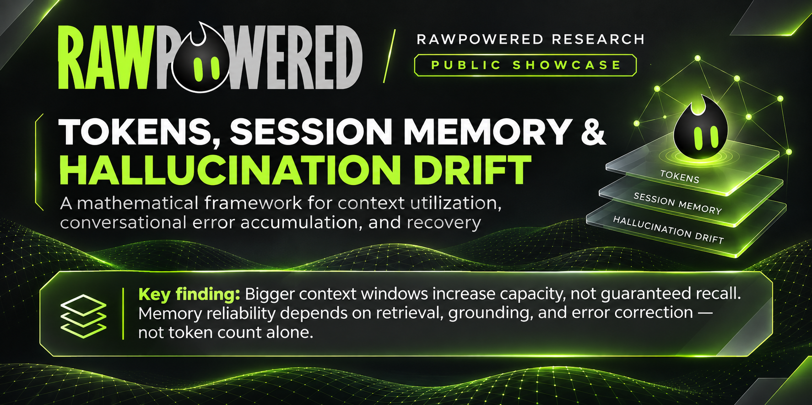
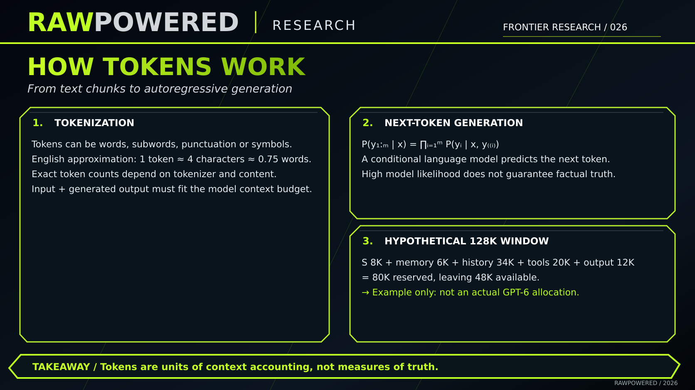
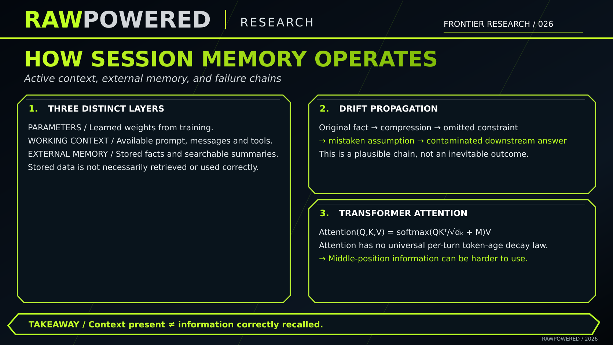
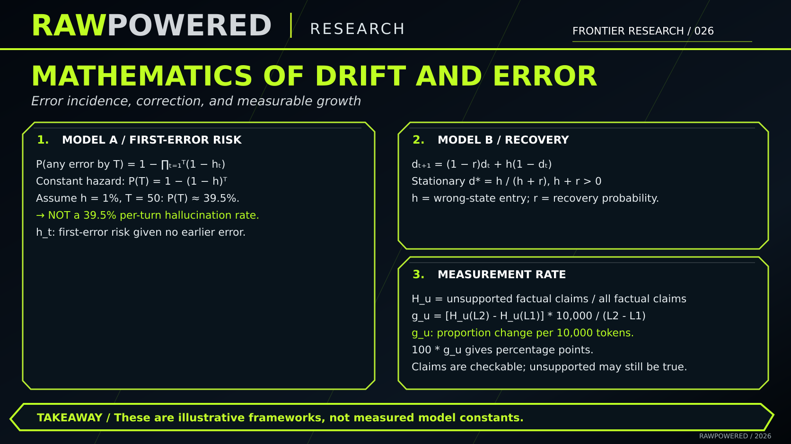
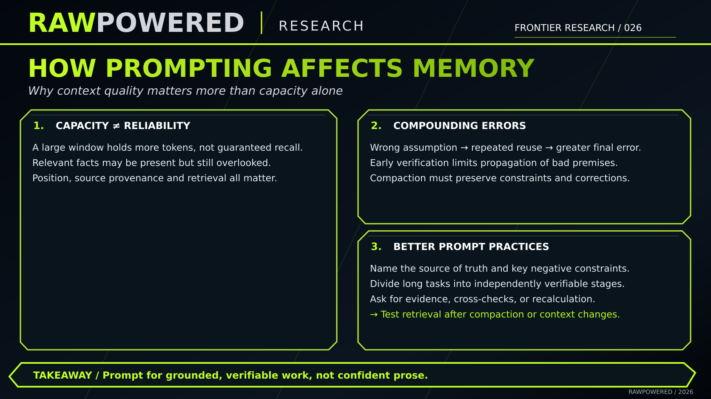
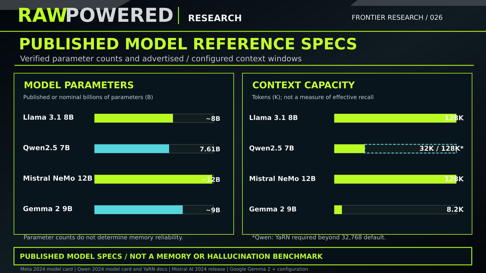
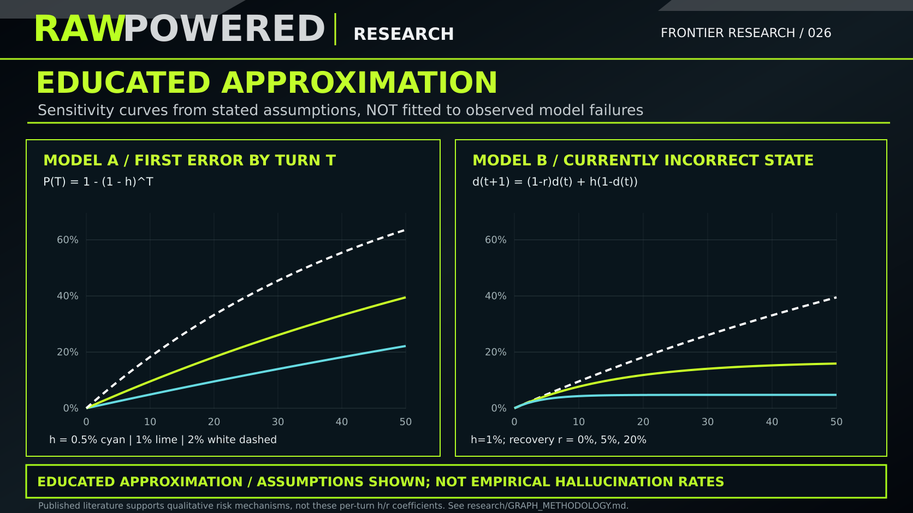

<p align="center">
  
</p>

# Tokens, Session Memory & Hallucination Drift
### A mathematical framework for context utilization, conversational error accumulation, and recovery

**Status:** Public research showcase · **Version:** 1.0 · **Prepared:** November 2026  
**Research series:** RawPowered Research · **Scope:** Large language models and assistant memory systems  
**Evidence level:** Published findings are cited; mathematical risk models and budget examples are illustrative, **not results of original model testing**. **Publication status:** Public research showcase maintained by RawPowered Research. The original working repository remains private and its Git history is not included.

> **Core finding:** Context-window size is a capacity limit, not a guarantee of reliable recall. There is no universal token count at which hallucination begins, nor a universal per-token growth rate. The answer requires measuring retrieval, factual grounding, error introduction, and error correction **separately**. [1–8]

---

## Research visual series: four educational slides and two evidence figures

The repository contains **four educational slides plus two supporting figures**, all as self-contained 16:9 vector (SVG) graphics. Their contents have text equivalents below for accessibility, citations, and auditability.

| # | Slide | Key concepts |
|:--:|---|---|
| 01 | [How Tokens Work](figures/01-how-tokens-work.svg) | Tokenization, autoregressive generation, hypothetical context budget |
| 02 | [How Session Memory Operates](figures/02-session-memory.svg) | Learned parameters, active context, external memory, attention |
| 03 | [Mathematical Growth of Drift / Error Probability](figures/03-error-probability.svg) | First-error survival model, correct/incorrect state transitions, measurement slope |
| 04 | [How Prompting Affects Your Session](figures/04-prompting-and-reliability.svg) | Context quality, compounding errors, practical mitigations |
| 05 | [Published Model Reference Specifications](figures/05-published-model-specs.svg) | Published parameter counts, context configuration caveats |
| 06 | [Educated Approximation: First Error & Recovery](figures/06-educated-approximation.svg) | Explicitly assumed per-turn hazards and correction sensitivity |






### Additional evidence and explanatory graphics





*The SVG editions are resolution-independent research graphics. Numerical examples are labeled hypothetical and should not be presented as measurements of a particular model.*

---

## 1. Tokenization and autoregressive generation

A **token** is a unit of model input or output. A token can represent a character, part of a word, a word, or punctuation; the segmentation depends on the tokenizer, language, and text. The commonly cited English approximation is **1 token ≈ 4 characters ≈ 0.75 words**. This is a rough conversion, not an identity. [1]

For an input context $x$ and an output sequence $y_{1:m}$, autoregressive generation is described by:

```math
P_\theta(y_{1:m}\mid x)=\prod_{i=1}^{m}P_\theta(y_i\mid x,y_1,\ldots,y_{i-1})
```

- $x$: provided input and available conversation context.
- $y_i$: output token at generation step $i$.
- $y_1,\ldots,y_{i-1}$: earlier generated output tokens.
- $\theta$: trained model parameters.

**Interpretation:** the model predicts tokens conditioned on context and previously emitted tokens. Token likelihood is **not** a calibrated measure of whether the resulting statement is true.

### Context-window accounting

A simplified per-invocation budget is:

```math
L_t=S_t+M_t+H_t+R_t+O_t,\qquad L_t\leq W
```

| Variable | Meaning |
|---|---|
| $S_t$ | System/developer instructions and protocol overhead |
| $M_t$ | Memory or personalization retrieved into active context |
| $H_t$ | Included conversation history |
| $R_t$ | Retrieved material, tool responses, files, or documents |
| $O_t$ | Budget for output, including reasoning tokens when applicable |
| $W$ | Maximum model context window |

The budget is **conceptual**: actual APIs differ in accounting, serialization, caching, multimodal encoding, and how reasoning items carry across turns. Reasoning tokens may consume part of the context/output budget even when not visible to the user. [1, 2]

#### Hypothetical budget — **not** a GPT-6 or other product specification

| Allocation | Tokens |
|---|---:|
| Instructions | 8,000 |
| Retrieved memory | 6,000 |
| Conversation history | 34,000 |
| Tools and documents | 20,000 |
| Output allowance | 12,000 |
| **Reserved total** | **80,000** |
| **Example window** | **128,000** |
| **Remaining capacity** | **48,000** |

A single invocation’s context occupation is different from **cumulative billed/processed tokens** across many turns, where repeated history can be processed again and again.

## 2. What “session memory” means

Do not collapse these three mechanisms into one:

| Layer | Persists where? | What it does | Common misconception |
|---|---|---|---|
| **Model parameters** | Learned weights | Encode knowledge and patterns from training | Ordinary chats rewrite the weights on every turn — **false** |
| **Working context** | Current invocation | Exposes instructions, messages, and retrieved materials to computation | Every historic message is always present verbatim — **not guaranteed** |
| **Persistent external memory** | Application-managed systems | Maintains facts, summaries, documents, or historical signals that may be retrieved later | Every stored fact is necessarily retrieved or correctly used — **false** |

Application implementations differ: some trim history, some preserve long transcripts, and some use compaction or retrieval. OpenAI documents separate memory features and API compaction mechanisms, but those documents do **not** reveal a fixed token-by-token retention formula for every ChatGPT session. [3, 4]

A plausible **failure chain**, not an inevitability:

**Original constraint → trimming/compaction or incomplete indexing → failed retrieval → incorrect assumption → later answer contaminated.**

A fact can also be present yet misused or overlooked; this is distinct from forgetting it.

### Transformer attention

The scaled dot-product attention calculation, with an additive mask $M$, may be written:

```math
\mathrm{Attention}(Q,K,V)=\mathrm{softmax}\left(\frac{QK^\top}{\sqrt{d_k}}+M\right)V
```

Here $Q$, $K$, and $V$ are query, key, and value matrices; $d_k$ is key dimensionality; $M$ can encode forbidden attention connections. This computation does **not** impose a universal “older tokens decay by X% per turn” law. [5]

Evidence from long-context tests shows that models may underutilize information placed in the **middle** of their provided context even though it fits within the window. [6]

## 3. Why drift and hallucination must be separated

This project treats four distinct outcomes as separate measurement targets:

1. **Availability failure:** the relevant information is absent from the current context.
2. **Recall/use failure:** it is present but not recovered or used correctly.
3. **Hallucination or unsupported claim:** a checkable output claim lacks adequate source support, or contradicts a trusted oracle; these are tracked as **different categories**.
4. **Error persistence:** an incorrect assumption is carried into later turns instead of being corrected.

Hallucinations can occur **in the first answer**, without approaching any context limit. Conversely, a long dialogue does not necessarily hallucinate or lose every older fact.

### Model A — probability that the *first* error has occurred by turn $T$

Define $h_t$ as the probability of a **first error on turn $t$**, conditional on no earlier error. Then:

```math
P(\text{at least one error by }T)
=1-\prod_{t=1}^{T}(1-h_t)
```

If the first-error hazard is constant, $h_t=h$:

```math
P(T)=1-(1-h)^T
```

**Illustration only:** $h=0.01,\ T=50$ gives $1-0.99^{50}\approx39.5\%$.

**Critical limitation:** 39.5% is the modeled probability of **at least one error somewhere by turn 50**; it is **not** a 39.5% hallucination rate on turn 50. The 1% input is an assumption and is not estimated from real user conversations.

### Model B — active drift with opportunities to correct it

Let $d_t$ be the probability the ongoing conversational state is wrong; $h$ be a transition probability from correct to incorrect; and $r$ be a recovery probability from incorrect to correct:

```math
d_{t+1}=(1-r)d_t+h(1-d_t)
```

The stationary incorrect-state probability is:

```math
d_*=\frac{h}{h+r}
```

for $h+r>0$. The time-step distribution converges to this value under the usual non-periodic conditions (in particular, excluding the deterministic alternating $h=r=1$ case). This is a **two-state Markov approximation**, not a discovered law of transformers.

The two models answer different questions:

- Model A: **Has an error ever occurred?**
- Model B: **Is an incorrect assumption still influencing the current state?**

## 4. How to measure hallucination growth

For a fixed benchmark definition and context length $L$, one possible *unsupported-claim proportion* is:

```math
H_u(L)=
\frac{N_{\text{unsupported checkable claims}}(L)}
{N_{\text{checkable factual claims}}(L)}
```

**Unsupported** is not synonymous with **false**. Report a separate *contradicted-claim proportion* $H_f(L)$ using a trusted ground-truth oracle or independently verified primary evidence. Also measure abstention and answer completeness.

To compare two context lengths:

```math
g_u=
\frac{H_u(L_2)-H_u(L_1)}{L_2-L_1}\times10{,}000
```

If $H$ is a number between 0 and 1, $g_u$ is a **change in proportion per 10,000 extra tokens**. Multiply by 100 to state the result in **percentage points per 10,000 tokens**.

Do **not** infer a universal growth curve from two samples. Context length, instruction distribution, document placement, turn count, prompt complexity, model checkpoint, inference settings, tools, and grading rules are potential confounders. Measure them in controlled experiments. See [the evaluation protocol](EVALUATION_PROTOCOL.md).

## 5. What the published evidence actually reports

| Study / source | Reported result | What it **does not** establish |
|---|---|---|
| Liu et al., *Lost in the Middle* (TACL 2024) [6] | Model performance is sensitive to the placement of relevant content; information in the middle may be harder to use. | A token-age-specific decay constant shared by all models |
| Hsieh et al., *RULER* (2024) [7] | In their 17-model suite, performance generally worsened with length; about half met their satisfactory-performance criterion at 32K. | That every modern model has the same 32K effective limit |
| Wu et al., *LongMemEval* (ICLR 2025) [8] | Reported roughly 30% accuracy degradation in the evaluated long-term memory settings. | A universal 30%-per-session memory loss rate |
| Laban et al., *LLMs Get Lost In Multi-Turn Conversation* (ICLR 2026) [9] | Reported an average 39% performance drop in multi-turn vs. single-turn evaluations across six generation tasks and 200,000+ simulated conversations. | A 39% per-turn hallucination probability |
| OpenAI’s memory and compaction docs [3, 4] | Describe retrieval/synthesis and strategies for maintaining a bounded active context. | Full implementation details or measured error dynamics for every assistant session |

**Research caution:** the papers evaluate different systems, tasks, metrics, and dates. Their percentages should **not** be combined into one error rate, interpreted as directly comparable, or generalized to a model not evaluated in the study.

## 6. Public model specifications, provenance, and educated approximations

**Three evidence classes must remain separate:**

| Evidence class | What may be claimed | Example |
|---|---|---|
| **Publisher-documented specification** | Model size and advertised/configured context, tied to the exact model | Llama 3.1 8B supports a published 128K context window [10] |
| **Peer-reviewed or publisher-reported experimental result** | A metric **only within the paper's benchmark conditions** | LongMemEval's ~30% degradation [8] |
| **Educated approximation — uncalibrated** | A possible mechanism or sensitivity curve given assumed coefficients | $h=0.01$ and $r=0.05$ in the Markov example; not a measured rate |

**Publicly documented model reference set:**

| Model / checkpoint family | Parameters | Published / configured context | What must be disclosed |
|---|---:|---:|---|
| Meta **Llama 3.1 8B** | 8B (nominal) | 128K tokens | Publisher model card; model license [10] |
| **Qwen2.5-7B** | 7.61B (reported) | 32,768 default; **131,072 with YaRN configuration** | Extended 128K is not the unmodified default and requires supported serving configuration [11] |
| **Mistral NeMo 12B** | 12B (nominal) | up to 128K | Published model size/window, not observed accuracy [12] |
| **Gemma 2 9B** | 9B (nominal) | 8,192 tokens in referenced Gemma configuration | Specify the checkpoint and the implementation used [13] |

**Parameter count, context capacity, and memory reliability are different dimensions.** A publisher's context claim should never be plotted as measured effective recall or a hallucination rate. Open-weight availability also does not make the model's training data, exact parameter tensors, or proprietary application memory behavior fully documented.


**Published specifications — source table:** [published-model-specs.csv](published-model-specs.csv). Model sources: [10–13]. The SVG uses nominal model classes for some parameter counts; Qwen's 7.61B figure is more precise. Actual runtime configurations should be recorded.

### Educated approximation: sensitivity curves, not reconstructed benchmarks


The left curve applies the first-error survival equation with **assumed** $h$ values of 0.5%, 1%, and 2% per turn. The right curve holds the **assumed** wrong-state entry rate at 1% per turn while varying **assumed** correction rates $r$ of 0%, 5%, and 20%. These are analytically calculated scenarios, **not regression fits, confidence intervals, or inferred failure rates for any named model**.

Calling these plots **educated approximations** means their structure is motivated by observed degradation and recovery difficulties in published studies, not that their parameters have been statistically estimated. The benchmark figures of ~30% (LongMemEval) and 39% (Laban et al.) cannot determine a universal per-turn $h$ or $r$. See [GRAPH_METHODOLOGY.md](GRAPH_METHODOLOGY.md) for exact assumptions and reproduction notes, and [EVALUATION_PROTOCOL.md](EVALUATION_PROTOCOL.md) for how to fit real coefficients.

## 7. Experimental plan for this repository

This repository is a **theoretical foundation** for a reproducible longitudinal evaluation; no new runtime benchmarks or model-certified results are claimed.

**Primary research question:** How do context length, evidence placement, turn count, context compaction, and correction opportunities affect accurate retrieval and factual grounding?

The proposed study varies:

- **Context length:** 4K / 8K / 16K / 32K / 64K / 128K tokens, only where the tested model supports them.
- **Evidence position:** beginning, middle, end.
- **Dialogue depth:** 1 / 5 / 20 / 50 turns.
- **Memory condition:** complete history, truncated history, summary/compacted history, verified external retrieval (when configurable).
- **Correction condition:** no correction; explicit authoritative correction; correction plus source verification.
- **Outcomes:** exact-fact recall, constraint adherence, unsupported statements, contradicted statements, answer completion, abstention, first-error hazard, persistence time, recovery rate.

For comparison, use matched tasks, seeded synthetic facts, an independent grading rubric, recorded model snapshot/configuration, and confidence intervals. Treat conversation, rather than individual sentence, as the statistical clustering unit. Store examples and annotations without private user data.

See [EVALUATION_PROTOCOL.md](EVALUATION_PROTOCOL.md) for the test plan, audit requirements, reporting template, and interpretation rules.

## 8. What better prompting can realistically improve

A larger context allows **more information to fit**, not necessarily **more reliable use of all of it**. Early unsupported assumptions can become repeated premises; verifying them may matter more than shortening a history.

For accuracy-critical work, prefer:

- State critical constraints explicitly and make them machine-checkable when possible.
- Keep an external source of truth for durable requirements; do not rely only on model memory.
- Break long tasks into verifiable stages, with explicit corrections when errors occur.
- Preserve provenance, dates, and negative constraints during summarization.
- Ask for evidence-linked claims, ground-truth checks, or recalculations rather than merely confident prose.
- Re-run retrieval tests after compaction and after switching model/configuration.

These measures are **risk reduction practices**, not guarantees. Their efficacy should be tested on representative workloads. [6–9]

## 9. Limitations, non-claims, and responsible interpretation

- **Not a causal proof** that tokens themselves increase hallucinations.
- **Not a published new benchmark** or trained hallucination predictor.
- **Not measurements of GPT-6**, ChatGPT internal memory allocations, or a private product's context management.
- The example 128K window, 80K reserved tokens, 1% hazard, and 39.5% illustration are **hypothetical**.
- The Markov state is an abstraction of conversation correctness, not a claim that an LLM has an internal binary “correct/incorrect memory flag.”
- Attention weights are not themselves a sufficient interpretability method or a guarantee of evidence retrieval.
- A user-supplied source can itself be inaccurate; “grounded in a source” and “true” are separate audit dimensions.
- Exact tokenizer, available window, inference implementation, and application memory controls are product and model specific.

## 10. Primary references — full citations

**[1] OpenAI.** “Understanding and counting tokens.” *OpenAI Help Center* (accessed November 2026).  
https://help.openai.com/en/articles/4936856-understanding-and-counting-tokens

**[2] OpenAI.** “Reasoning models.” *OpenAI API documentation* (accessed November 2026).  
https://developers.openai.com/api/docs/guides/reasoning

**[3] OpenAI.** “Memory in ChatGPT.” *OpenAI Help Center* (accessed November 2026).  
https://help.openai.com/en/articles/8590148-memory-faq  
Also: OpenAI, “Dreaming: Better memory for a more helpful ChatGPT,” June 4, 2026. https://openai.com/index/chatgpt-memory-dreaming/

**[4] OpenAI.** “Compaction.” *OpenAI API documentation* (accessed November 2026).  
https://developers.openai.com/api/docs/guides/compaction

**[5] Vaswani, Ashish; Shazeer, Noam; Parmar, Niki; Uszkoreit, Jakob; Jones, Llion; Gomez, Aidan N.; Kaiser, Łukasz; and Polosukhin, Illia.** “Attention Is All You Need.” *Advances in Neural Information Processing Systems 30 (NeurIPS 2017).* arXiv:1706.03762.  
https://arxiv.org/abs/1706.03762

**[6] Liu, Nelson F.; Lin, Kevin; Hewitt, John; Paranjape, Ashwin; Bevilacqua, Michele; Petroni, Fabio; and Liang, Percy.** “Lost in the Middle: How Language Models Use Long Contexts.” *Transactions of the Association for Computational Linguistics* **12** (2024): 157–173. DOI: **10.1162/tacl_a_00638**.  
https://aclanthology.org/2024.tacl-1.9/

**[7] Hsieh, Cheng-Ping; Sun, Simeng; Kriman, Samuel; Acharya, Shantanu; Rekesh, Dima; Jia, Fei; Zhang, Yang; and Ginsburg, Boris.** “RULER: What’s the Real Context Size of Your Long-Context Language Models?” *arXiv* preprint **arXiv:2404.06654** (2024).  
https://arxiv.org/abs/2404.06654  
Benchmark implementation: https://github.com/NVIDIA/RULER

**[8] Wu, Di; Wang, Hongwei; Yu, Wenhao; Zhang, Yuwei; Chang, Kai-Wei; and Yu, Dong.** “LongMemEval: Benchmarking Chat Assistants on Long-Term Interactive Memory.” *International Conference on Learning Representations (ICLR)*, 2025.  
https://proceedings.iclr.cc/paper_files/paper/2025/hash/d813d324dbf0598bbdc9c8e79740ed01-Abstract-Conference.html  
Benchmark implementation: https://github.com/xiaowu0162/LongMemEval

**[9] Laban, Philippe; Hayashi, Hiroaki; Zhou, Yingbo; and Neville, Jennifer.** “LLMs Get Lost In Multi-Turn Conversation.” *International Conference on Learning Representations (ICLR)*, 2026. arXiv:2505.06120.  
https://proceedings.iclr.cc/paper_files/paper/2026/hash/59f6421e64707225fdf5b28840679a07-Abstract-Conference.html  
Preprint: https://arxiv.org/abs/2505.06120

**[10] Meta AI.** “Llama 3.1 Model Card.” *Meta Llama Models*, 2024. Published 8B/70B/405B variants and 128K context window.  
https://github.com/meta-llama/llama-models/blob/main/models/llama3_1/MODEL_CARD.md

**[11] Qwen Team.** “Qwen2.5-LLM: Extending the Boundary of LLMs.” *Qwen*, September 19, 2024. Published model parameters, context capacities and model variants.  
https://qwenlm.github.io/blog/qwen2.5-llm/  
**Qwen.** “Qwen2.5-7B-Instruct Model Card.” Hugging Face. Describes standard 32,768-token configuration and extended YaRN context.  
https://huggingface.co/Qwen/Qwen2.5-7B-Instruct

**[12] Mistral AI and NVIDIA.** “Mistral NeMo.” *Mistral AI*, July 18, 2024. Published 12B model class and up-to-128K context window.  
https://mistral.ai/news/mistral-nemo/

**[13] Google DeepMind.** “Gemma 2 Model Card.” *Google AI for Developers*, 2024. Model sizes and training details.  
https://ai.google.dev/gemma/docs/core/model_card_2  
**Google.** *gemma_pytorch* model configuration (Gemma 2 sequence length).  
https://github.com/google/gemma_pytorch/blob/main/gemma/config.py

Machine-readable academic citations are in [references.bib](references.bib).

---

### Attribution and intended use

**RawPowered Research** — independent synthesis and conceptual modeling of publicly documented research. The project is not affiliated with the publishers or vendors cited above. Mathematical frameworks in Sections 3–4 are modeling choices for future tests, not newly established empirical constants. Graphs are either published specifications or explicitly uncalibrated sensitivity analyses. Graphical elements are original research visualizations; source papers remain the intellectual work of their respective authors. Sharing results externally should preserve the scope notes and citations.

**Publishing scope:** This repository contains only independently curated research text, source-backed citations, and presentation assets. It does not reproduce any private working repository history.
